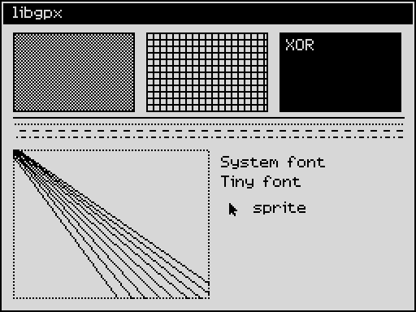
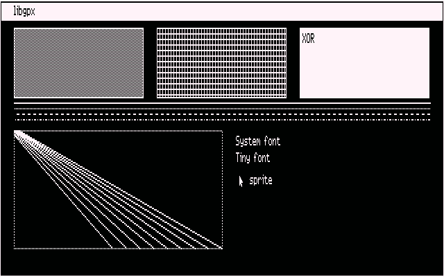
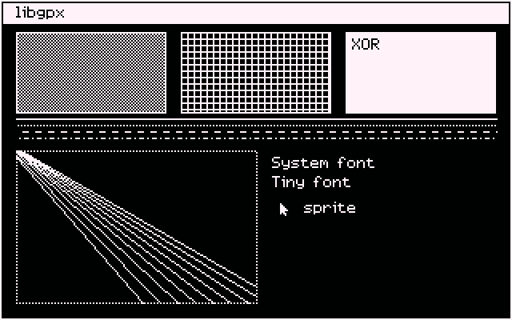
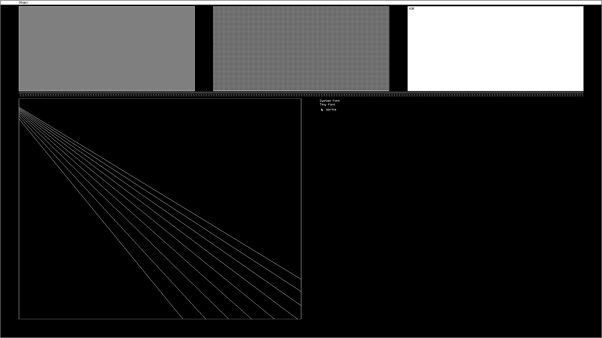
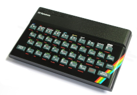
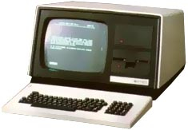
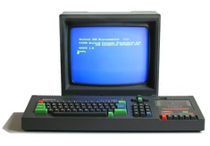

# libgpx

A 1-bit-per-pixel graphics library for Z80 machines and the Rasta Linux
framebuffer emulator. Z80 targets use hand-optimised assembly; Rasta uses C11.

libgpx gives you pixels, lines, selected-edge boxes, opaque and stencil pattern
fills, circles, polygons, text and sprites behind one API that behaves the same
on every supported machine, so a program written against it draws the same
picture wherever it runs.

**The full programming manual is
[docs/manuals/PROGRAMMING-LIBGPX.md](docs/manuals/PROGRAMMING-LIBGPX.md)** —
every function, its parameters, worked examples, complete programs and
screenshots from every supported backend.

| Machine | Screen | Backend |
|---|---|---|
| ZX Spectrum 48K | 256 x 192 | `src/zx` |
| Iskra Delta Partner | 1024 x 256 or 1024 x 512 | `src/partner` |
| Amstrad CPC | 640 x 200 or 320 x 200 | `src/cpc` |
| Rasta (Linux) | 1920 x 1080 | `src/rasta` |

The machines have almost nothing in common. The Spectrum has a packed
framebuffer the CPU reads and writes directly; the Partner has an EF9367
drawing coprocessor and display memory the CPU cannot read at all; the CPC
interleaves its framebuffer into eight banks and changes how many pixels
fit in a byte depending on the display mode. libgpx hides the difference.

The panels example on several display layouts:

| | |
|---|---|
| ZX Spectrum, 256 x 192 |  |
| Amstrad CPC, 640 x 200 |  |
| Amstrad CPC, 320 x 200 |  |
| Rasta, 1920 x 1080 |  |

The [Rasta guide](docs/manuals/RASTA.md#screenshots) also shows the API
showcase, circles and polygons at 1920 × 1080.

## Building

The Z80 targets build inside Docker images carrying the X Tools Z80
toolchain (`xcc`, `xas`, `xld`, `xar`, `xprog`) and an emulator, so
Docker and Python 3 are the only requirements — no host toolchain.

| Machine | Image |
|---|---|
| ZX Spectrum | `wischner/xcc-z80-zx-spectrum` |
| Iskra Delta Partner | `wischner/xcc-z80-idp` |
| Amstrad CPC | `wischner/xcc-z80-cpc` |
| Rasta | `libgpx-rasta:local` (built automatically from `scripts/docker/rasta.Dockerfile`) |

```bash
make lib           # bin/libgpx.lib          (ZX Spectrum)
make partner-lib   # bin/partner/libgpx.lib  (Partner)
make cpc-lib       # bin/cpc/libgpx.lib      (CPC, both display modes)
make rasta-lib     # bin/rasta/libgpx.a + libgpx.so + Rasta viewer
make rasta-run     # build and open the Full HD demo on X11/XWayland
make rasta-tests   # sanitizer regressions and an X11 viewer smoke test
make build         # all of them, plus the test binaries
make clean
```

Rasta implements the full API, including bitmap fonts, all six stock
cursors, save-under sprites, circles and polygons. Its pinned emulator
checkout is downloaded once into `build/rasta/` and reused on later builds,
including after `make clean`. `make distclean` also removes that cache.
The first Rasta build needs internet access to fetch the Ubuntu packages
and emulator. Drawing applications need only libc; SDL2 belongs to the
viewer. See [the Rasta guide](docs/manuals/RASTA.md) for linking, framebuffer
configuration, X11 use and packaging.

Every Z80 implementation remains hand-written assembly. Hardware-facing
engines, including selected-edge boxes, live under `src/zx`, `src/partner`,
and `src/cpc`.
Line drawing stays in each backend: ZX and CPC replace
COPY pixels directly in one raster pass, while Partner alone performs the
extra strokes required by the EF9367. The advanced circle and polygon assembly
is under `src/common` too. Rasta provides the equivalent native C
implementations under `src/rasta`. `make ADVANCED=0` (`no` and `false` also
work) builds only the core set; the default builds both. Since the library is
an archive, a program that draws no circles pays nothing for them either way.

One CPC library serves both display modes. Pass `GPXM_CPC_640X200` (the
default) or `GPXM_CPC_320X200` to `gpx_create()`; it programs the CRTC and
the Gate Array to match and records the geometry, and `gpx_width()` reports
it from then on. The modes pack a different number of pixels into a byte, so
the mode test is deliberately coarse — it sits once per run, once per row or
once per byte, never once per pixel.

## Using it

Include the one public header, call `gpx_create()` once, draw, and link
against your machine's library.

```c
#include "libgpx.h"

void main(void)
{
    gpx_t *gpx = gpx_create(GPXM_DEFAULT);
    rect_t r = {10, 10, 100, 60};

    gpx_clrscr();
    gpx_draw_rectangle(gpx, &r, CO_FORE, BM_CPY, 0xFF, 0);
    gpx_draw_text(gpx, 14, 14, "hello", gpx_get_system_font(),
                  CO_FORE, BM_CPY, 0);
    gpx_destroy(gpx);
}
```

Text is opaque by default, including the advance between adjacent characters.
Call `gpx_set_text_background(gpx, GPX_TEXT_BG_TRANSPARENT)` before drawing an
overlay that should preserve both the glyph background and character spacing.
For patterned lines and fills, `BM_CPY` is likewise opaque: pattern one bits
paint the requested colour and zero bits paint its inverse. Use `BM_OR` when
pattern zeroes should leave the framebuffer untouched.

Compile and link for the ZX Spectrum:

```bash
docker run --rm -u $(id -u):$(id -g) -v "$PWD":/work -w /work \
    wischner/xcc-z80-zx-spectrum sh -lc '
        xcc -mz80 -std=c11 -Os -Iinclude -c -o build/hello.rel hello.c
        xcc -mz80 -nostartfiles -o build/hello.bin \
            build/crt0.rel build/hello.rel bin/libgpx.lib \
            -Wl,--oformat=binary -Wl,-b,_CODE=0x8000'
```

For the Partner, swap the image for `wischner/xcc-z80-idp`, the library
for `bin/partner/libgpx.lib`, and the load address for `0x100` (CP/M
`.com`). The C source does not change.

For the Amstrad CPC, use `wischner/xcc-z80-cpc`, `bin/cpc/libgpx.lib` and
`bin/cpc/crt0-cpc.rel`. The result is a raw binary that runs at `0x8000`
with no firmware underneath it: `gpx_create()` programs the CRTC and the
Gate Array itself and pages both ROMs out, the same way the Partner backend
programs its own PIO.

```bash
docker run --rm -u $(id -u):$(id -g) -v "$PWD":/work -w /work \
    wischner/xcc-z80-cpc sh -lc '
        xcc -mz80 -std=c11 -Os -Iinclude -c -o build/hello.rel hello.c
        xld --oformat=binary -b _CODE=0x8000 -nostartfiles \
            -o build/hello.bin bin/cpc/crt0-cpc.rel \
            build/hello.rel bin/cpc/libgpx.lib'
```

## Demos

Every demo builds for the Spectrum and Partner, and the documentation capture
also builds it directly for both CPC modes and Rasta where applicable. Each
page explains the source and places emulator screenshots side by side so
backend and screen-geometry differences are visible.

| Demo | What it demonstrates |
|---|---|
| [Demo 1 — dimensions and cursors](samples/demo1/README.md) | fixed 256x192 fill, reported screen size, stock cursors, sprite show/hide |
| [Demo 2 — drawing-API smoke test](samples/demo2/README.md) | fixed 1024x256 diagnostic scene and physical-screen clipping |
| [Demo 3 — portable examples](samples/demo3/README.md) | resolution-adaptive panels and sprite restoration programs |
| [Demo 4 — circles](samples/demo4/README.md) | circle outlines, pattern fills, XOR overlap and clipping |
| [Demo 5 — polygons](samples/demo5/README.md) | polygon outlines, concave and self-intersecting fills, even-odd |

Build any demo for both targets, or select one backend:

```bash
make -C samples/demo1 build
make -C samples/demo2 zx
make -C samples/demo3 partner
```

The output is a Spectrum `.tap` and a Partner CP/M `.com`. The manual's
[demo reference](docs/manuals/PROGRAMMING-LIBGPX.md#demo-directory-reference)
connects these programs to the API concepts they exercise.

## The three backends, side by side

| |  |  |  |
|---|:---:|:---:|:---:|
| | **ZX Spectrum** | **Iskra Delta Partner** | **Amstrad CPC** |
| Display | 256 x 192 | 1024 x 256 | 640 x 200 / 320 x 200 |
| Z80 clock | 3.5 MHz | 4 MHz | 4 MHz |
| Drawing | software | EF9367 coprocessor | software |
| Library code and assets | 8,986 B | 9,509 B | 10,299 B |
| ...core only (`ADVANCED=0`) | 6,816 B | 7,339 B | 8,129 B |

The CPC is the largest because one library serves both display modes, and
mode 1 packs four pixels to a byte where mode 2 packs eight -- so the span,
blit and line paths each carry a second form. These are uncompressed `_CODE`
bytes summed across library members, including fonts and cursors but excluding
startup code and writable data; an application links only the members it uses.

The advanced half costs the same 2,170 bytes on every backend: 1,280 B
for `gpx_fill_polygon`, 381 for `gpx_fill_circle`, 327 for
`gpx_draw_circle`, 159 for `gpx_draw_polygon`, and 23 in shared arithmetic
helpers. A program pays only for the archive members it calls. Each helper
has its own member, so selecting one shape does not pull another shape's
helpers into the program.

The [September 2026 optimization report](docs/research/OPTIMIZATION-2026-09.md)
records before/after sizes, raw timings, validation and known test limitations.
Font data and formats are unchanged.

The [11 September ZX follow-up](docs/research/OPTIMIZATION-ZX-2026-09-11.md)
saves another 420 bytes against the working-tree version with opaque patterns
and selected-edge boxes (9,406 → 8,986 B). All nine ZX microbenchmarks are
unchanged or faster; bitmap/font formats and byte-based drawing are retained.

### Speed

`make crossbench` draws the *same picture* on every machine -- fixed
coordinates inside a 256x192 box that fits every display -- and times it, so
the numbers can be compared directly. The per-backend suites
(`make zx-bench`, `make cpc-bench`) size their work from `gpx_width()` and
so cannot be.

These figures are the v1.1.0 baseline; they predate the opaque-pattern and UI
composition additions in this working tree.

Milliseconds, because the Spectrum's Z80 runs at 3.5 MHz and the other two at
4 MHz. Lower is better; the best in each row is in bold.

| Benchmark | ZX Spectrum | Partner | CPC 640x200 | CPC 320x200 |
|---|--:|--:|--:|--:|
| 64 solid rays, all octants | 721 | **66** | 665 | 696 |
| the same rays, dashed | 683 | 1,632 | **630** | 661 |
| 8 solid fills, 248x184 | 691 | **474** | 570 | 717 |
| 8 patterned/XOR fills | 881 | 4,069 | **743** | 1,122 |
| 16 circle outlines, 4 radii | **1,226** | 1,259 | 1,417 | 1,408 |
| 8 solid discs, r=90 | 1,485 | **989** | 1,723 | 1,793 |
| 8 ten-point star outlines | 265 | **79** | 258 | 264 |
| 8 ten-point star fills | 3,250 | **2,729** | 3,491 | 3,539 |
| 200 sprite show+hide pairs | **1,500** | 2,032 | 2,340 | 2,573 |
| 60 lines of text, 3 modes | **4,796** | 6,331 | 4,835 | 5,186 |
| 16 full-screen clears | **455** | 538 | 558 | 558 |

What the table shows:

* **Partner hardware vectors remain fastest for solid lines.** Selected
  horizontal patterns now use one to three hardware passes. This mixed
  patterned-fill workload still takes 4.6 times the Spectrum's time because
  it also needs scalar plotting for arbitrary pattern rows. Alternating
  `BM_CPY` lines now compose a solid inverse-colour base with shifted native
  XOR strokes.
* **Direct pixel calls bring Partner circle outlines close to Spectrum.**
  Filled circles and polygons put Partner first because their scanlines use
  hardware horizontal runs. Its star outline takes 79 ms versus 258 on CPC.
* **Polygon fills carry substantial edge-processing cost.** Each row walks
  edge records and sorts crossings before emitting spans; reducing that work
  helps every backend.
* **CPC is strong on byte-based raster work.** Mode 1 generally adds packing
  work to spans and bitmaps because four pixels occupy each screen byte;
  circle outlines are a small exception. Spectrum remains fastest for the
  sprite workload here.
* **Partner Tiny bitmaps now use packed GDP commands.** Connected strokes
  and pen-up moves avoid software delta decoding, reducing this sprite
  workload from 4,607 to 2,032 ms and text from 9,610 to 6,331 ms.
* **Clears cover different amounts of memory.** Partner clears over five
  times as many pixels as Spectrum; this row is not a fixed-area comparison.

Measured with `make crossbench`; the emulators are cycle-accurate, so the
numbers are reproducible rather than sampled.

## Testing

```bash
make tests           # everything below
make zx-tests        # ZX differential suite vs an independent C oracle
make partner-gdp-tests   # Partner suite on the emulated EF9367
make cpc-tests       # CPC suite, both display modes, on amstrad-cpc-mcp
make cpc-bench       # CPC micro-benchmarks, in T-states, both modes
make conformance     # one program on all three backends, compared pixel for pixel
make crossbench      # the same picture timed on all three, for comparison
```

The current Partner emulator has pre-existing recorded-golden and conformance
mismatches, reproduced before and after the optimization pass. See the
[validation report](docs/research/OPTIMIZATION-2026-09.md#existing-partner-test-failures)
for the exact failing phases; neither its goldens nor its acceptance budgets
were relaxed.

`make conformance` is the gate that keeps the backends from drifting
apart: it compiles a scenario once per backend, runs it on every
emulator and diffs the rasters against the ZX. The CPC is checked in
both display modes and has to match *exactly* -- it shares the ZX's
font, cursors and software rasteriser, so it has no licence to differ. See [tests/README.md](tests/README.md) for how the
suites work and how to add a scenario.

## Repository layout

| Path | Contents |
|---|---|
| `include/libgpx.h` | the public API and data formats |
| `src/zx/`, `src/partner/`, `src/cpc/` | the three backends, hand-written Z80 assembly |
| `samples/` | dual-platform demos with illustrated README pages |
| `tests/` | test suites, benchmarks, size and coverage tooling |
| `docs/manuals/` | the programming manual |
| `docs/images/screenshots/` | emulator captures, regenerated by `scripts/docs/` |
| `docs/images/diagrams/` | hand-drawn figures |
| `docs/images/platforms/` | photographs of the machines |
| `docs/standards/` | coding standards this project follows |
| `docs/todo/` | working notes, not part of the library |
| `scripts/mk/` | shared toolchain and Docker image definitions |
| `scripts/run/`, `scripts/check/`, `scripts/docs/` | launchers, style checks, doc generation |
| `bin/`, `build/` | generated artifacts |
| `archive/` | older snapshots, not used by the current build |

## Licence

GPL2 — see [LICENSE](LICENSE).
