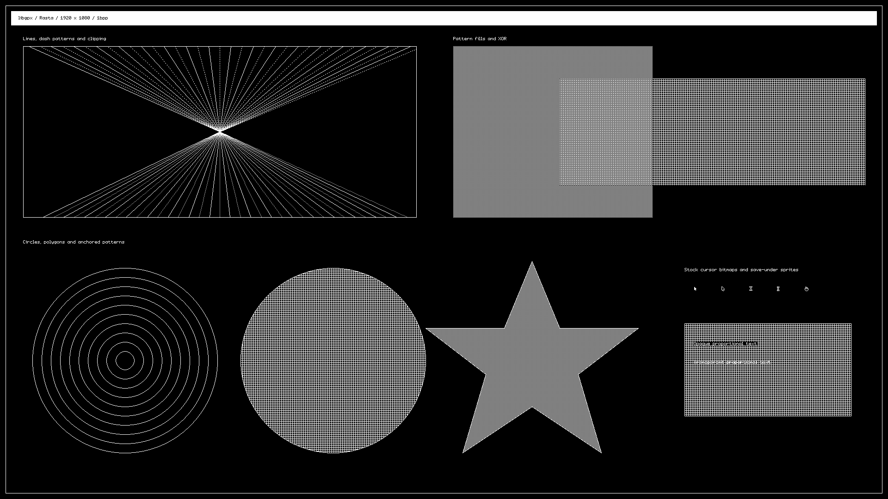
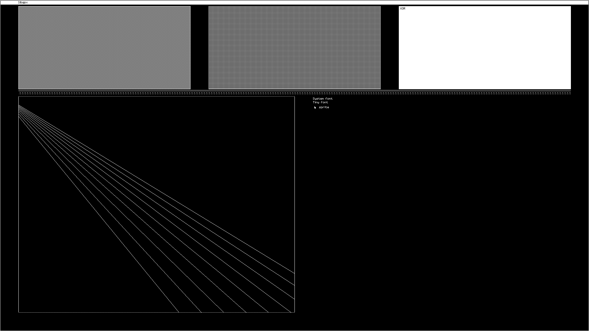
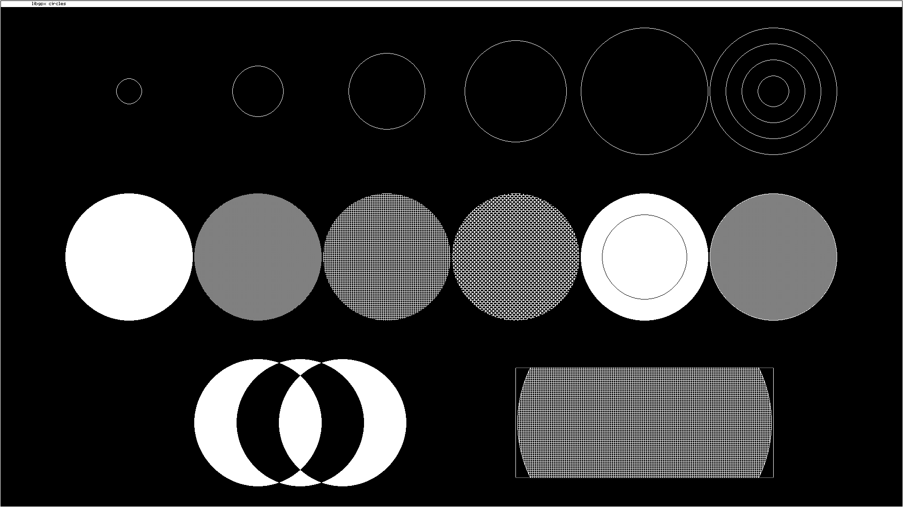
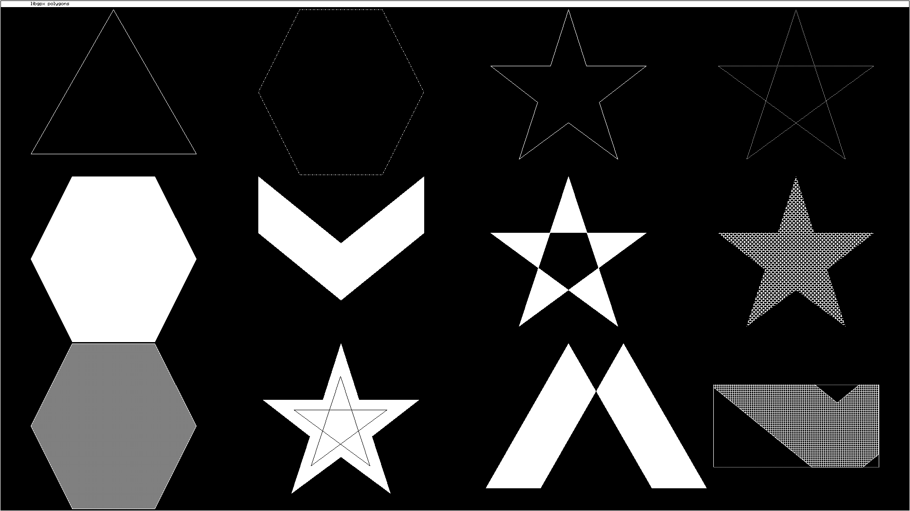

# Rasta target

Rasta is a native Linux backend for the complete libgpx API, with a fixed
1920 × 1080 monochrome display. It builds `libgpx.a` and `libgpx.so` for the
Docker host's native architecture. It uses the same public `libgpx.h` as
the Z80 targets.

## Screenshots

These are unscaled 1920 × 1080 captures of the actual Rasta X11 display.
The capture script waits until the displayed pixels match the completed
framebuffer before saving each PNG. Click an image to inspect it at full size.

Full API showcase: lines, clipping, patterns, XOR, circles, polygons,
cursor bitmaps and text.



The portable panels example:



Circle outlines, patterned discs, XOR and clipping:



Polygon outlines, concave shapes and patterned fills:



Regenerate all four screenshots with `make rasta-screenshots`. The build
uses the full library and captures through Xvfb inside Docker, so no host
display is required.

## Build and run

Only Docker is needed for the Rasta targets. From the repository root:

```sh
make rasta-lib
make rasta-run
make rasta-tests
make package-rasta VERSION=dev
```

`make rasta` is an alias for `make rasta-lib`. The build creates a small
Ubuntu 24.04 toolchain image with GCC, CMake, SDL2 and X11. The emulator is
fetched from [tstih/rasta](https://github.com/tstih/rasta) at commit
`3dd2426f5c4bddf7d0eb4961d73c2e8c68e3510a` into `build/rasta/`. Rebuilding
uses that checkout without contacting GitHub. The fetch is locked and
installed atomically, and a mismatched existing checkout is reported
without overwriting it. `make clean` preserves the download; `make
distclean` removes it. Docker also caches the toolchain image layers.

Outputs:

| Path | Contents |
| --- | --- |
| `bin/rasta/libgpx.a` | Native static library |
| `bin/rasta/libgpx.so` | Native shared library |
| `bin/rasta/include/libgpx.h` | Public header |
| `bin/rasta/rasta` | SDL2 viewer |
| `bin/rasta/demo` | Showcase, built by `rasta-demo` or `rasta-run` |
| `build/release/libgpx-rasta-VERSION.tar.gz` | Libraries, header, guide and license |

`make rasta-run` forwards `DISPLAY`, the X11 socket and your Xauthority
file into Docker. It works with X11 or XWayland. It starts the viewer,
waits for the framebuffer file, then draws the showcase; close the window
to finish. No broad `xhost +` permission is needed. If your session stores
its cookie elsewhere, set `XAUTHORITY` to that file. The viewer starts at
1:1 scale; its `+` and `-` keys adjust zoom.

## Application integration

The library has no SDL or X11 dependency. It writes directly to a shared
file using `mmap(MAP_SHARED)`. Start the viewer before the application:

```sh
bin/rasta/rasta --width 1920 --height 1080 --bpp 1 --scale 1 \
    --framebuffer /tmp/rasta.framebuffer
```

Compile your application against the static library in a second terminal:

```sh
cc -std=c11 -Wall -Wextra -Ibin/rasta/include app.c \
    bin/rasta/libgpx.a -o build/app
build/app
```

The example uses a host C compiler. The same compile command can run in
`libgpx-rasta:local` with the repository mounted at `/work`. Processes in
different containers must share the framebuffer directory; their private
`/tmp` directories are distinct. The supplied launcher runs the viewer
and demo together and handles this automatically.

Application source:

```c
#include "libgpx.h"
#include <stdio.h>

int main(void)
{
    gpx_t *gpx = gpx_create(GPXM_RASTA_1920X1080);
    if (!gpx) {
        perror("gpx_create");
        return 1;
    }
    gpx_draw_circle(gpx, 960, 540, 400, CO_FORE, BM_CPY, NULL);
    gpx_draw_text(gpx, 900, 540, "Hello, Rasta!",
        gpx_get_system_font(), CO_FORE, BM_CPY, NULL);
    gpx_destroy(gpx);
    return 0;
}
```

Use `GPX_RASTA_FRAMEBUFFER=/path/to/screen.fb` to select another file and
pass the same path to Rasta's `--framebuffer` option. The default is
`/tmp/rasta.framebuffer`. `gpx_create()` creates or resizes the file to
259,200 bytes and clears it. Failure returns `NULL` with `errno` set.
One context may be active per process; a second create returns `EBUSY`.
Destroy unmaps it and allows a fresh create. It leaves the file and final
picture available to the viewer.

Rasta truncates its framebuffer at startup, so launch it before drawing.
Keep both processes on the same geometry and avoid reconfiguring the
viewer while an application has the framebuffer mapped.

## API behavior

All 23 public functions are implemented. The display has one page:
`gpx_set_page()` is a no-op and `gpx->pages` is 1. Pixels are packed left
to right, MSB first, with a 240-byte stride. `CO_BACK` is black and
`CO_FORE` white in Rasta. Copy, XOR, inclusive clipping and pattern phases
follow the raster targets. Reversed clip rectangles draw nothing.

The system and tiny fonts both use the Spectrum's Envy raster font, and
the five stock cursor IDs use its masked cursor assets. Standard and
masked 1bpp bitmap encodings are supported; Partner tiny vector streams
are platform-specific and are ignored. Serialized bitmap headers remain
five bytes on native compilers. Sprites use the documented 37-byte
save-under buffer, support up to 16 × 16 pixels, and restore their full
captured box. Their origin must be onscreen. Draw/hide on the same page
and at the same position, restoring overlapping sprites in reverse order.

`ADVANCED=0` (also `no`, `false` or `off`) excludes the four circle/polygon
functions, as on the Z80 targets. The default includes everything. The
build tracks this setting, including when switching back to the full
library. Context and drawing state are single-threaded. Input remains
Rasta's UDP interface and is outside the libgpx drawing API.

## Validation

`make rasta-tests` runs C and C++ builds with full warnings, ASan and
UBSan. It compares randomized rendering against the existing C reference
renderer; checks Full HD coordinates, clipping, pattern anchoring,
bitmap layout, malformed payload declarations, sprite restoration,
XOR behavior and context failure/recreation; and audits exported API
symbols. It also runs the real Rasta viewer and demo under Xvfb at
1920 × 1080. CI tests both full and core-only libraries.
